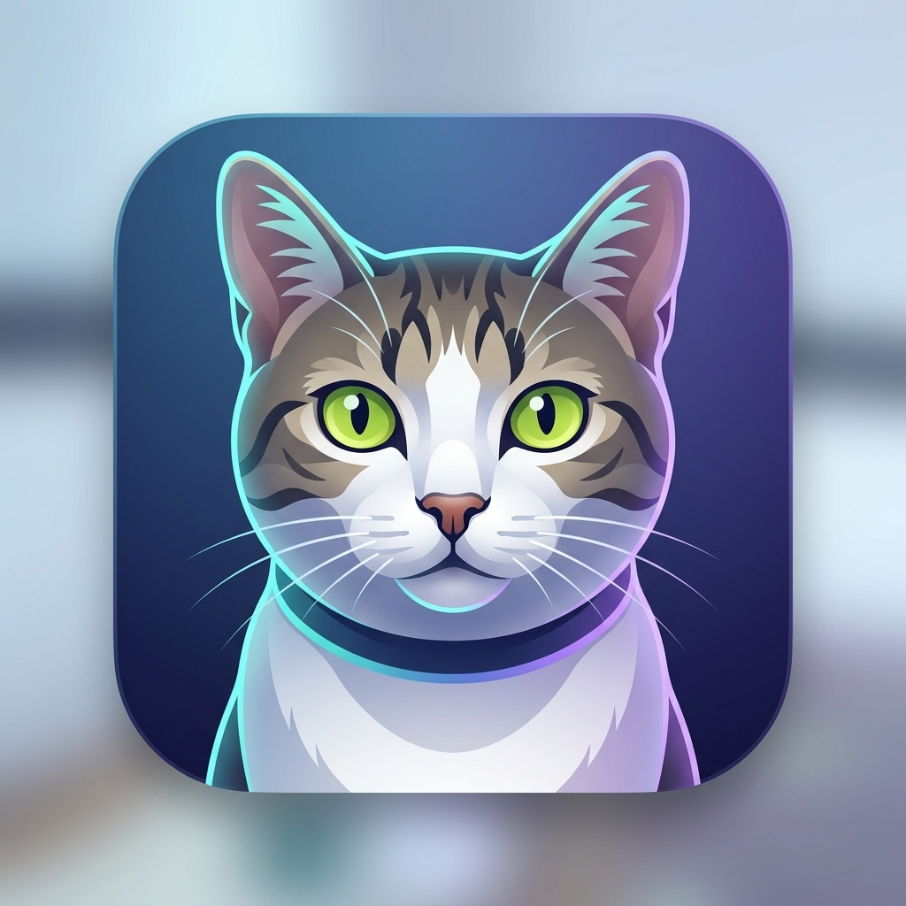
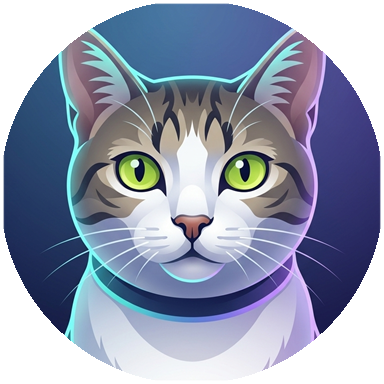

<p align="center">
  <a href="README.md">English</a> · <a href="README.zh-CN.md">简体中文</a> · <a href="README.zh-TW.md">繁體中文</a> · <a href="README.ja.md"><b>日本語</b></a>
</p>
<p align="center">
  <picture>
    <source media="(prefers-color-scheme: dark)" srcset="icons/apiapia-logo.svg">
    <source media="(prefers-color-scheme: light)" srcset="icons/apiapia-logo.svg">
    
  </picture>
</p>

<p align="center">
  <strong>長期記憶をもつ賢い猫のアシスタント · Personal AI Assistant with Long-Term Memory</strong>
</p>

<p align="center">
  <a href="VERSION"></a>
  <a href="LICENSE"></a>
  
  
  
  
  
  
  
  
</p>

---

## 🐱 Apiapia について（ブランドストーリーと着想）

> 「エメラルドのように透き通った瞳で、夜昼問わずキーボードの傍らに静かに寄り添っていた猫。いま、あなたのデジタル世界で決して物事を忘れない賢いアシスタントへと生まれ変わりました。」

<p align="center">
  
  
  
</p>

<p align="center">
  <em>左：モデルとなった愛猫の実写 · 中央：iOS ネイティブ質感 Web App アイコン · 右：ブランド円形アイコン</em>
</p>

**Apiapia** のモデルは、愛らしいトラ柄とエメラルドグリーンの瞳をもつ実在の飼い猫です。日々の暮らしで鋭い直感と静かな温もりを届けてくれる存在を、最先端 AI の長期ベクトル記憶とマルチモデル推論によってデジタルアシスタントとして具現化しました。

- **薄れることのない温もり**：新しい会話のたびに「記憶喪失」になる一般的な LLM とは異なり、独自のベクトル記憶エンジン（Mem0 OSS + pgvector）が仕事の好みや生活習慣、事実の断片を大切に蓄積します。
- **話すほどに深まる理解**：端末や時間をまたいで関連事実を自動で想起。会話のたびに自己紹介を繰り返す必要はありません。
- **全デバイスでの洗練された体験**：手描きのブランドシンボルに加え、モバイルとデスクトップの双方で使いやすさと親しみやすさを両立しました。

---

## ✨ 主な機能

- 🧠 **長期ベクトル記憶システム（Mem0 OSS 2.2.1 + pgvector）**：事実の自動抽出と想起、秒単位タイムスタンプ、ベクトル意味検索、インライン編集、JSON ワンクリック書き出し。
- 🌐 **全モデル対応の自律型ウェブ検索（Web Search）**：時事的なニーズを自律判定。Tavily AI ネイティブ検索と DuckDuckGo キー不要フォールバック、行内リアルタイム引用リンクをサポート。
- 🤖 **マルチベンダー LLM のシームレスルーティング**：OpenAI、Anthropic Claude（Extended Thinking 対応）、Google Gemini、OpenRouter、ローカル Ollama を統一サポート。
- 🎙️ **音声対話とスマート言語学習**：Whisper 音声認識（STT）、多言語音声合成（TTS）、日本語の振仮名（ルビ）表示や動詞活用分解を伴うスマート翻訳。
- 🌍 **第三者ライブラリ依存ゼロの 4 言語国際化 (i18n)**：UI、エラー応答、プロンプト枠組み、記憶抽出の 4 層すべてで 日本語 / 简体中文 / 繁體中文 / English に対応。
- 📱 **iOS PWA とレスポンシブ UI**：Safari から「ホーム画面に追加」するだけでスタンドアロン没入起動。ノッチ安全領域対応と 5 つの独立タブ。
- 🔒 **企業レベルのセキュリティと隔離**：JWT による厳格な本人確認、Fernet 対称暗号化による API キー保管、`<untrusted_document>` によるプロンプトインジェクション防御。

---

## 🚀 クイックスタートと導入手順

本プロジェクトは完全にコンテナ化されています。Docker Compose を使えばサーバーでもローカルでもコマンド一発で起動できます。

### 1. 環境変数の設定

テンプレートから設定ファイルをコピーします：

```bash
cp .env.example .env
```

`.env` を開き、**必須項目である `POSTGRES_PASSWORD`**（データベースのパスワード）を設定します：

```env
POSTGRES_PASSWORD=your_secure_password_here
# 任意：OpenRouter や Tavily などの API キー
OPENROUTER_API_KEY=
TAVILY_API_KEY=
```

### 2. Docker Compose での一括起動

```bash
docker compose up --build -d
```

Compose は 3 つのサービスを自動で連携起動します：
- `postgres`: pgvector 拡張を組み込んだ PostgreSQL 17 コンテナ。
- `backend`: FastAPI Python バックエンド（DB スキーマ同期と Mem0 初期化を自動実行）。
- `frontend`: Next.js コンテナ（バックエンドの健全性を確認後、ポート `3000` で待受）。

### 3. アプリケーションへのアクセス

- **Web UI**: `http://localhost:3000`
- **Swagger API ドキュメント**: `http://localhost:8000/docs`
- **ヘルスチェック**: `http://localhost:8000/api/health`

---

## 🛠️ ローカル開発ガイド

コントリビューターおよびローカル開発者向けの手順です：

### フロントエンド開発 (Next.js)

```bash
cd frontend
npm install # または pnpm install
npm run dev
```
`http://localhost:3000` で開発サーバーが起動します。

### バックエンド開発 (FastAPI)

```bash
cd backend
python -m venv venv
source venv/bin/activate  # Windows: .\venv\Scripts\activate
pip install -r requirements.txt
uvicorn app.main:app --reload --port 8000
```
> **備考**: バックエンド開発には pgvector が有効な PostgreSQL が必要です（`docker compose up postgres -d` で起動可能）。

---

## 🏗️ アーキテクチャ

```text
                         Browser / iOS Safari Web App
                                     │
                                     ▼
                            ┌─────────────────┐
                            │     Next.js     │ (Port 3000)
                            │ React + TS 前端 │
                            └────────┬────────┘
                                     │ HTTP / SSE
                                     ▼
                            ┌─────────────────┐
                            │     FastAPI     │ (Port 8000)
                            │   Python 後端   │
                            └────────┬────────┘
                                     │
                   ┌─────────────────┼─────────────────┐
                   │                 │                 │
                   ▼                 ▼                 ▼
                LLM Layer         Mem0 Layer       PostgreSQL
                   │                 │                 │
            ┌──────┼──────┐          │           ┌─────┴─────┐
            ▼      ▼      ▼          ▼           ▼           ▼
           GPT   Claude  Gemini   pgvector    Chat Logs    Users
                                     │
                                     ▼
                              Long-term Memory
```

---

## 📱 主な機能と画面ルーティング

| ルート | 説明 |
| :--- | :--- |
| `/login` | セキュアな JWT 認証。ログイン前にトップバーで言語を切り替え可能。 |
| `/chat` | メイン対話画面。ピン留めソート、リアルタイム検索、添付ファイル解析、SSE ストリーミング。 |
| `/memory` | **記憶ダッシュボード**。ベクトル意味検索、秒単位のタイムスタンプ、インライン編集、JSON 書き出し。 |
| `/settings` | 4 言語切替、ペルソナ調整、創造性スライダー、テーマ切替、暗号化 API キー管理。 |
| `/usage` | **利用量とコスト分析**。モデル別・期間別のトークン消費分析、管理者向けのセッション監査。 |

---

## 💾 データの永続化とバックアップ

`docker-compose.yml` で定義されたボリューム：
- `postgres_data`: PostgreSQL テーブルと Mem0 pgvector コレクション。
- `mem0_data`: Mem0 ローカル履歴インデックス。

バックアップ例：
```bash
docker exec -t apiapia_postgres pg_dump -U postgres apiapia > backup_$(date +%Y%m%d).sql
```

リストア例：
```bash
cat backup_xxx.sql | docker exec -i apiapia_postgres psql -U postgres -d apiapia
```

---

## 📜 リリースノート (Release Notes)

### 🚀 最新リリース：v2.27.0 (2026-10-16)

本バージョンは**モデル選択器のモバイル操作性の刷新**です。长期以来「パネルが狭く、選択しにくい」という課題を抱えていたモバイル側のパネルを**全幅ボトムシート**に変更し、画面高の半分近くを占めていたカテゴリ絞り込みを**1行のチップ**に圧縮しました。その過程で「無料」フィルタが有料モデルまで含めていた不具合も是正し、不要なコードの整理も行いました。

#### 1. モバイル形態の刷新：ボトムシートが上部の細板を 대체
- **全幅ボトムシート**：`md` 未満の幅ではボトムシート（`86dvh` の固定高さ、上角丸、ドラッグハンドル、`env(safe-area-inset-bottom)` のセーフエリア内側余白）で開きます。従来はトップバーの狭いトリガーに固定され、会話内容の上に浮かぶ「画面の上端に貼り付いた細い板」として見えていましたが、スマートフォンの縦の余白はほとんど使われていませんでした。
- **PC はポップオーバーを維持し、両者は同一のパネルコードを共有**：検索・絞り込み・キーボード操作・ARIA はすべて同一のマークアップのため、二つの実装が乖離することはありません。
- **ソフトキーボードが自動表示されなくなりました**：ダイアログ既定の自動フォーカスを抑止し、パネルを開いた瞬間にキーボードがモデル一覧を覆う問題を解消しました。モデル行の用途タグは 3 個から 2 個に減らし、狭い画面での折り返しを減らしています。

#### 2. カテゴリ絞り込みを縦並びリストから1行チップへ
- **約 335px → 32px**：7 つのグループは 1 行のチップとして描画されます。モバイルでは横スクロール＋チップ単位のスナップ、デスクトップでは自動折り返しです（スクロールバーを隠した横スクロールは、デスクトップでは「届かない」ことになるためです）。
- **入れ子スクロールの解消**：従来はパネル内に「カテゴリ区」と「モデル一覧」の 2 つがあり、それぞれ `38dvh` に制限されたスクロール区でした。そのため、パネルを開くたびに小さいスクロール区を一度スクロールしてからようやく「すべて」に到達していました。**このパネルに残ったスクロール区は 1 つだけ**となり、空いた高さはすべてモデル一覧に充てられます。スマートフォンでは一覧の表示可能高さが約 40% 増えました。
- **開いた位置で整列**：選択中のカテゴリを画面内へスクロールするため、行末にある選択も「選択が失われた」と誤解されません。

#### 3. 絞り込み順の変更と「無料」の意味の修正
- **新しい並び順**：無料 → おすすめ → 深い推論・思考 → 執筆・翻訳 → 画像・文書読解 → プログラミング → すべて。
- **「高速・無料」から「無料」へ**：判定を `is_free` のみに絞り込みました。以前は `fastFree` タグ付き **または** `is_free` だったため、価格区分が「低価格」の**有料**モデル（`GLM-Flash`、`Qwen-Flash`、`MiniMax-M3`、`MiMo`）まで混入し、「無料」で絞り込んでも実際には課金される状態でした。
- **既定の絞り込みを「推測」しなくなりました**：指定した既定グループが利用できない場合は、別のグループに勝手に倒れず、全量を表示します。

#### 4. 多色分けと誤解を招く矢印の削除
- **緑・琥珀・主色の配色をやめました**：7 つのグループは価格（無料）、能力（4 つの用途）、順位（おすすめ）、フォールバック（すべて）と、性質の異なる 4 つの意味を持つものです。色分けはそれらを互いに比較できる同種項目として見せかけており、これが「選び方が科学的でない」原因そのものです。選択状態は主色の塗りつぶしに統一し、グループの意味は区切り線で表します（無料 / おすすめ ｜ 用途 ｜ すべて）。
- **回転するシェブロンを削除**：右端の 90 度回転矢印は存在しない階層展開を示唆していますが、実際には結果が変わるだけです。

#### 5. 死んだコードの削除
- **呼び出し元のない実装を削除**：`sortByPinnedThenActivity`（3 つの呼び出し元はすべて分割版 `groupByTimeBuckets` に移行済み）、`UserAvatarDropdown` の互換エイリアス（`UserAvatarMenu` への改名後に残ったもので、コメントは「5 つの画面が使用」と書いていたが実際には 0 画面）、および呼び出し元を失った `RECOMMENDED_CHAT_MODELS`（これに依存していた設定画面の推奨カード自体はすでに削除され、コメントだけが現実と乖離していました）。
- **インポートグラフの全体スキャン**：すべてのソースファイルについて参照を確認した結果、未使用のファイル・コンポーネント・依存パッケージはありませんでした。`@radix-ui/react-slider` は元から未インストール（スライダーは手書き実装）のままです。

---

### v2.26.0 (2026-10-16)

本バージョンは**サイト全体のフォント・タイポグラフィ階層の再構築、モバイル・PC両面での高精細な可読性改善、および多言語（i18n）辞書の徹底的なスリム化**を目的とした重要なアップデートです。長年の課題であった Markdown 見出しの文字サイズ逆転を解消し、高解像度ディスプレイやスマートフォンにおける微小文字の視認性を抜本的に向上させ、未定義 CSS クラスを根絶して全4言語の辞書をゼロ冗長に整理しました。

#### 1. 排版階層の再構築と見出しサイズ逆転の解消
- **Markdown 見出しの体系的標準化**：`h3`（15px）および `h4〜h6`（13px）が本文（16px）より小さく表示されていた不具合を完全に解消。`h1`（24/28px）、`h2`（20/24px）、`h3`（18/20px）、`h4`（16/18px）、`h5`（15/16px）、`h6`（14px）のスムーズなレスポンシブ階層を確立。
- **コードブロックの閲覧標準整合**：PC 画面でのコードブロック本文フォントサイズを 13px から 14px に引き上げ、GitHub、VS Code、ChatGPT デスクトップ版の標準と統一。上部アクションボタンも 12px に拡大。
- **テーブルとインラインコードの強化**：データテーブルのセルおよびインラインコードを `text-xs sm:text-sm` にレスポンシブ化し、横長テーブルも快適に閲覧可能に。

#### 2. CJK 行高の最適化と微小文字の体系的底上げ
- **行高の余裕確保**：`2xs`（11px）と `xs`（12px）の行高を 15px / 17px に拡大し、画数の多い中日文字（「嚢」「蔵」「題」など）の潰れや上下の途切れを解消。
- **主要パネルの 11px からの脱却**：メッセージ下部のアクションバー（コピー/読み上げ/再生成/引用等）、利用量統計・ランキングカード、費用・推移データ、セッション履歴、記憶整理 Diff 比較、AI 画像・動画カード、単語学習カードなどの微小文字を 12px/14px に引き上げ。
- **タッチ操作の視認性向上**：モバイル画面でのアクションバーとタイムスタンプの既定透過度を 50% から 75% に引き上げ、ホバーがないタッチ画面での薄れを解消。

#### 3. スタイルの堅牢化と無効クラスの根絶
- **`text-3xs` の完全根絶**：Tailwind 未定義の無効クラス `text-3xs` をすべて特定・置換し、言語切り替え、コマンドヒント、発音ボタンが本番ビルドでも正しくスタイルされるように修正。
- **任意ピクセル指定の統一**：各所に散在していた `text-[10px]` 等の任意値をすべてデザインシステムの標準トークンへ集約。

#### 4. 多言語（i18n）辞書のゼロ冗長化クリーンアップ
- **83 件の未使用キーを削除**：AST 解析により、全 4 言語（簡体字・繁体字・英語・日本語）で使われていないキーを完全削除し、辞書容量を削減。
- **バックエンドエラーコード整理と翻訳漏れ解消**：未参照の `NO_LLM_CREDENTIALS` を削除し、ログイン画面のプレースホルダー翻訳バインドを補完。

#### 5. モデル特性タグとリスト取得の最適化
- **直感的なガイドタグ**：価格帯やマルチモーダル等の特性タグを拡充し、モデル選定をスムーズに。
- **モデル取得機構の統一**：起動時の自動同期フローを整え、冗長なローカル保存ファイルを整理。

---

### v2.25.0 (2026-10-14)

本バージョンは**記憶システムの自律整理と初期導入体験の向上**を目的とした重要なアップデートです。記憶整理専用モデル（Consolidation LLM）の個別設定機能、AI 記憶整理マルチステージ進捗アニメーション、および `openrouter/free` 公式無料スマートルーティングへの標準移行を行いました。

---

### v2.24.0 (2026-10-13)

本バージョンは**サイト全体の国際化アーキテクチャの着地**をみた重要なアップデートです。自作の軽量 i18n フレームワークにより、简体中文 / 繁體中文 / English / 日本語 の 4 言語でフロントエンド UI、バックエンドのエラー応答、AI プロンプト、記憶抽出をすべてカバーしました。また、スマート翻訳の翻訳先言語は UI 言語に追従するようになりました。

#### 1. 4 言語対応フレームワーク（第三者依存ゼロ）
- **自作 i18n、URL プレフィックスなし**：言語偏好は `localStorage` と Cookie に保存され、即時反映されます。
- **4 層を完全にカバー**：UI 文言、HTTP エラー応答、AI プロンプト枠組み、長期記憶抽出・検索トリガーのすべてを言語別に描画。
- **型レベルのキー名検証**：`t("...")` のキーはコンパイル時に検証されるリテラル union で、辞書テーブルの整合性を担保。
- **ローカライズ整形**：日付、数値、ファイルサイズ、相対時間が UI 言語に追従。

#### 2. 3 箇所の言語切り替え導線
- **ログインページのトップバー**：エラーメッセージを見る前に言語を切り替え可能。
- **デスクトップのトップバー**：テーマ切り替えの横に常設。
- **環境設定 · 外観**：自言語自称と英語名を併記。

#### 3. スマート翻訳の翻訳先言語が UI 言語に追従
- **自前の言語は UI で決定**：英語 UI は英語へ、日本語 UI は日本語へ、繁体字 UI は繁体字へ翻訳。
- **同一言語の自動単方向化**：同一言語選択時は「任意の外国語 → 自前言語」へ自動フォールバック。

#### 4. AI プロンプトの二言語戦略
- **枠組みは言語に追従**：ペルソナ、見出し、時刻基準、検索誘導、排版規約を言語ごとに記述。
- **推論ガードレールを維持**：推論の罠を防ぐアンカー例を厳格に保持。
- **二重の言語指示注入**：先頭と末尾に指示を配置し、出力言語を確実に統制。

#### 5. バックエンドエラーメッセージの全面ローカライズ
- **エラーコード + パラメータ化**：文言を `core/messages.py` に集約。
- **`Accept-Language` 標準ヘッダー対応**：CDN や外部連携でも自然に機能。

#### 6. 添付ファイルの複数選択とアップロード上限の統一
- **複数選択の修正**：ファイルやギャラリーから複数ファイルを一度に選択可能。
- **上限の統一**：添付 10 件、単体 20MB、合計 40MB を 56MB のリクエストボディゲートと整合。

<details>
<summary><b>📜 過去のリリースノートを展開（v2.23.0 ~ v2.22.0）</b></summary>

<br />

#### v2.23.0 リリースノート
- **チャット入力欄の状態記憶と過去セッションのスマート復元**：セッションごとの創作状態を記憶し、スムーズに復元。
- **本番環境 Docker ビルドの厳密性担保**：TypeScript strict モードにおけるインデックスアクセスの安全性を強化。
- **バックエンドモデルサービスの再構成**：モデルカタログ処理（`catalog.py`）を起動タスクから分離。
- **モデル同期権限の集約**：リアルタイム同期を管理者専用に制限。

#### v2.22.0 リリースノート
- **創作メニューの集約**：スマート翻訳、画像生成、動画生成、音声認識を `+` メニューへ統合。
- **スマート翻訳と語学学習の強化**：日本語の振仮名（ルビ）表示、動詞の活用形分解、類似例文の生成。
- **単方向翻訳の単一ターン隔離**：文脈を持ち越さない低遅延翻訳モード。
- **システムプロンプトのカスタム設定**：環境設定から全体ペルソナを自由に編集可能。

</details>

---

## 🤝 コントリビューション

Issue および Pull Request を歓迎します！
1. 本リポジトリをフォークし、ブランチを作成（`feature/amazing-feature` など）。
2. コードスタイルを整えてコミット。
3. 変更内容を詳しく記述して Pull Request を作成してください。

---

## 📄 ライセンスと商標について

- **コードライセンス**: 本プロジェクトのソースコードは [MIT License](LICENSE) のもとで公開されています。
- **ブランドおよびマスコットの権利**: 「Apiapia」のブランド名、公式ロゴ、猫のマスコットイラストおよび `icons/`、`frontend/public/` 内のオリジナル意匠は著作権で保護されており、MIT ライセンスの対象外です。

---

## ⚠️ 免責事項

1. 本プロジェクトは個人の日常アシスタント業務、学習・研究および技術交流を目的としています。
2. サードパーティ API（OpenAI、Anthropic、OpenRouter、Tavily など）を利用する際は、各サービスの利用規約および法令を遵守してください。
3. 本ソフトウェアの利用により生じたいかなる損害・費用・データ損失についても、作者は責任を負いません。