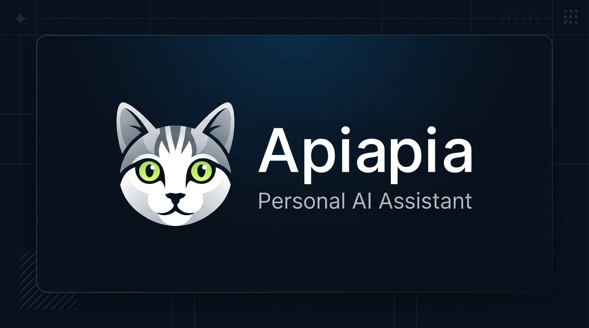

<p align="center">
  <picture>
    <source media="(prefers-color-scheme: dark)" srcset="icons/apiapia-logo.svg">
    <source media="(prefers-color-scheme: light)" srcset="icons/apiapia-logo.svg">
    
  </picture>
</p>

<p align="center">
  <strong>一只有长期记忆的智能猫咪助理 · Personal AI Assistant with Long-Term Memory</strong>
</p>

<p align="center">
  
  
  
  
  
  
  
</p>

---

## v2.10.0 发布说明

- **跨设备无缝接力（切端自动刷新）**：新增 `lib/appResume.ts` 前台回前台事件总线与 `lib/useRefreshOnResume.ts` 统一刷新钩子，一次性覆盖「原生 App 切后台回前台 / 浏览器切标签页与切回窗口 / 移动端 SPA 切页签」三类场景。在电脑上聊完天再拿起手机，消息与历史记录自动补齐，无需杀掉进程重开。刷新带完整保护：流式输出中、正在重新生成、正在编辑记忆、偏好设置有未保存改动时自动跳过，绝不打断当前操作或覆盖未提交的草稿（`messageEditingRef` 内联编辑守卫）。
- **全应用统一确认弹窗 (ConfirmDialog)**：新增带语义图标与危险态红色按钮的标准确认弹窗，全面替换原生 `confirm()` 与各页面手写弹层；主题切换、新版本更新提示、消息操作、删除记忆、会话管理、模型同步等入口全部收敛到同一套视觉与文案规范。
- **交互反馈准则落地 (Dialog vs Toast)**：新增 `lib/feedback.ts` 确立全站判定口诀——**要决策或要读 → Dialog；只是回报结果 → Toast**，并在代码注释中固化判定依据；「同步模型列表」在设置页语言模型、绘图模型与聊天页三处统一为同一提示形式与文案。
- **消息操作栏重排 + 流式结束即时可用**：后端将助手回复的持久化提前到 `done` 事件之前，并把新分配的 `message_id` 随 `done` 载荷下发，AI 回答刚生成完即可重生成 / 复制 / 查看，无需重新加载会话才解锁按钮；用户提问的「编辑重发 / 复制」与助手回答操作栏统一为同一套位置、字号与图标规格。
- **移动端输入体验回归原生**：输入框按 `pointer: coarse` 判定主输入设备（而非窗口宽度，避免桌面窗口缩窄误判），手机 / 平板软键盘回车恢复为换行、点击按钮发送，桌面端保持回车发送、Shift+回车换行；同时正确避开中文输入法候选上屏（`isComposing` / `keyCode 229`），彻底消除「打完字回车没反应」的困惑。
- **Tooltip 体验与细节打磨**：新增全局单例 `TooltipProvider`（`delayDuration=200` / `skipDelayDuration=300`），在一排图标按钮上划过时提示连续接力而非逐个重新计时；主题切换与新版本提示重写为统一 popover 形态；底部标签栏移除与 `ActionTooltip` 重复的原生 `title` 提示。
- **历史页删除行为修正**：在历史记录中删除当前正在查看的会话后，停留在历史页而不是被强制跳回对话页。

### 历史版本：v2.9.0 发布说明

- **全新双轨智能画图引擎**：系统同时支持两种画图体验。① 专业 AI 位图生图：无缝兼容 OpenAI DALL·E 3 与 SiliconFlow（开源生图之王 Flux.1 / SD3.5），聊天中直接自动生成真实插画与高清大图；② 矢量代码绘图：针对 SVG 矢量画作，提供聊天气泡内即时原生图形渲染容器，支持「预览图形 / 查看代码」切换与一键下载 `.svg` 文件。
- **ChatGPT 级沉浸式排版交互**：AI 回答全面采用沉浸式无边框排版，加入打字机呼吸光标（`animate-pulse`），提问气泡采用软灰圆角药丸质感，居中黄金阅读宽度（`max-w-3xl`）带来舒适体验。
- **现代化代码块与一键复制**：全面升级代码渲染组件，配备独立暗色语言标识顶栏与右上角一键复制代码按键，支持高亮与快速复制反馈。
- **工业级 Vercel AI SDK 架构对接**：前端引入 `@ai-sdk` 规范，实现标准数据流（Data Stream）与 Tool Invocations 协议，状态卡片优雅呈现工具调用中与完成态。
- **全方位大模型幻觉与泄露防御**：新增通用多级输出清洗引擎，彻底阻断模型输出中可能残留的未执行工具伪代码（如 `<tool_call>`）、ReAct 思维草稿及安全审核标签（`User Safety: safe` 等）。
- **智能意图评估器优化**：放宽对金融市场、汇率与代码数学混合查询（如 QQQ、标普500、USD/CNY）的判定规则，并强化 LaTeX 语法清洗，确保行情事实检索精准触发。

### 历史版本：v2.8.0 发布说明

- 长期记忆召回升级为“稳定用户档案 + 当前问题相关记忆”两层结构，并加入重要度、时间衰减、去重和上下文长度控制。
- 记忆以不可执行的参考资料区块注入模型，降低记忆内容触发提示注入的风险。
- 自动提炼记忆记录类型、置信度和用户原始证据；跨轮 Dreaming 摘要继续使用统一去重流程。
- 流式输出改用标准 SSE 事件解析，处理跨网络分片、多行 `data:`、UTF-8 结束刷新、断流检测和结构化错误。
- 统一处理 OpenAI/OpenRouter 的内容分片、reasoning 和 refusal 返回，提升多模型回答完整性。

## 🐱 关于 Apiapia（品牌故事与灵感）

> “她有一双清澈如绿宝石般的眼睛，安静地趴在键盘旁陪伴着日夜；而现在，她化身为你数字世界里永不忘事的智慧助理。”

<p align="center">
  
  
  
</p>

<p align="center">
  <em>图左：原型小猫真实生活照 · 图中：iOS 原生质感 Web App 图标 · 图右：站内品牌圆形头像</em>
</p>

**Apiapia** 的原型是一只真实存在、有着可爱虎斑花纹与碧绿双眸的家养猫咪。在日常生活中，猫咪用敏锐的直觉和长久的陪伴给予家人温暖与安心；在 **Apiapia 助理系统** 中，这份陪伴被赋予了前沿 AI 的长期记忆与逻辑推理能力：

- **永不遗忘的温度**：不同于常规大模型每次开启新对话就“失忆”的局限，Apiapia 借助自主向量记忆引擎（Mem0 OSS + pgvector），将你的工作偏好、生活习惯与事实碎片默默珍藏。
- **越聊越懂你**：跨设备、跨时间段自动召回关联事实，无需反复自报家门，交流如同与相识已久的老友交谈般默契顺畅。
- **全端优雅呈现**：不仅拥有精心手绘的猫咪品牌标识，更针对移动端与桌面端进行全套视觉重构，带来兼具科技质感与亲和力的使用体验。

---

## 📲 iOS 浏览器 Web App（PWA）全套图标体系

系统现已全面适配 **Apple iOS Safari** 及现代主流浏览器的 Progressive Web App (PWA) 标准，支持从 Safari 一键「**添加到主屏幕**」，获得媲美原生 App 的沉浸式无边框独立运行体验（Standalone Mode）：

<p align="center">
  
</p>

### 📱 1. 全套图标规格一览

| 平台 / 场景 | 图标文件 | 尺寸 / 格式 | 用途说明与规范 |
| :--- | :--- | :--- | :--- |
| **iOS 主屏幕** | `apple-touch-icon.png` | 180×180 PNG | iOS 设备添加主屏幕的默认图标，适配 Retina 视网膜屏 |
| **iPhone Retina @3x** | `apple-touch-icon-180x180.png` | 180×180 PNG | 适配 iPhone 14/15/16 Pro 等 @3x 超清视网膜屏幕 |
| **iPad Pro @2x** | `apple-touch-icon-167x167.png` | 167×167 PNG | 专为 10.5" / 11" / 12.9" iPad Pro 定制的高清图标 |
| **iPad / iPad mini** | `apple-touch-icon-152x152.png` | 152×152 PNG | 适配 iPad Air 与 iPad mini 的标准高清视网膜显示 |
| **iPhone 标准 @2x** | `apple-touch-icon-120x120.png` | 120×120 PNG | 适配标准分辨率 iPhone 显示及 Spotlight 搜索结果 |
| **Web App 启动图标** | `icon-192x192.png` | 192×192 PNG | PWA Manifest 标准通用图标，移动端启动画面与快捷方式 |
| **Web App 高清图标** | `icon-512x512.png` | 512×512 PNG | PWA 高分辨率图标、应用商城展示及 Splash 加载页 |
| **Android 自适应图标** | `icon-maskable-192x192.png` | 192×192 PNG | 自带 20% 安全边距，适配圆形、圆角矩形等任意裁切 |
| **Android 高清自适应** | `icon-maskable-512x512.png` | 512×512 PNG | 遵循 W3C Maskable 规范，杜绝图标边缘被截断 |
| **多分辨率 Favicon** | `favicon.ico` | 16/32/48 ICO | 桌面浏览器标签页标准 ICO 格式，内嵌 16/32/48 三合一数据 |
| **现代浏览器 Favicon** | `favicon-32x32.png` / `16x16` | 32×32 / 16×16 | 现代化桌面与移动浏览器标签页高清位图 |
| **矢量高保真 Favicon** | `icon.svg` | Scalable SVG | 现代 Safari / Chrome 原生矢量 Favicon，无限缩放不失真 |

### 🛠️ 2. iOS 极速安装为 Web App 步骤

1. 在 iPhone 或 iPad 上使用 **Safari 浏览器** 打开 Apiapia 网址（例如 `http://<your-server-ip>:3000`）。
2. 点击屏幕底部（或顶部）导航栏的 **「分享」按钮（向上箭头图标 ⎋）**。
3. 在弹出菜单中向下滑动，选择 **「添加到主屏幕」（Add to Home Screen）**。
4. 确认应用名称为 **Apiapia** 并点击右上角「添加」。
5. 返回手机桌面，即可看到带有官方猫咪图标的 **Apiapia App**。点击直接进入全屏沉浸模式，免去浏览器地址栏与底部工具栏干扰！

---

## 🌟 核心理念与架构特点

1. **前后端分离与解耦**：
   - 前端采用 **Next.js (React 18 + TypeScript + Tailwind CSS + shadcn/ui)**，基于 Radix 原语与 CSS 变量主题，负责 UI、交互、流式 SSE 渲染、移动端 Web App 适配及版本自动更新检测，移动端抽屉与桌面端三栏共用同一套响应式布局。
   - 后端采用 **FastAPI (Python 3.12)**，统一负责 LLM 路由调度、长期记忆提取生命周期、全网实时检索、文档解析、会话数据库及敏感 API Key 加密。

2. **全模型通用智能全自动联网检索 (Web Search Engine, v2.3.0)**：
   - **全模型普惠**：不依赖特定模型厂商的联网功能，无论是 Claude、GPT、Gemini、DeepSeek，还是本地 Ollama 部署的模型，全部自动具备联网搜索能力。
   - **智能自动判定 (Auto-Decision)**：系统自主识别时效性新闻、天气、汇率、股票行情、外部事实、最新技术资讯等需求，按需自动搜索；日常闲聊、纯代码或逻辑运算保持零延迟免搜。
   - **三档模式随心控**：输入框支持「自动判定 (默认) / 强制开启 / 关闭」一键循环切换，并自动持久化用户偏好。
   - **多级免 Key 高可用**：未配置 Key 时内置 DuckDuckGo 多级异步搜索引擎与解析器，100% 免费开箱即用；配置 `TAVILY_API_KEY` 后自动升级为 **Tavily AI 原生搜索为主 + DuckDuckGo 兜底**，搜索质量与 RAG 相关性更强（`/api/health` 的 `web_search` 字段可查看当前生效引擎）。
   - **实时检索与网页溯源**：流式生成过程中动态呈现检索中动效及检索词；回答下方持久化提供「🌐 参考了 X 个网页来源」交互式可折叠卡片，展示网页标题、摘要与一键直达外链。

3. **长期记忆与聊天记录严格分离**：
   - **聊天记录**：完整保存在 PostgreSQL `conversations` 与 `messages` 中，用于历史溯源与恢复上下文。
   - **长期记忆 (Mem0 OSS 2.2.1)**：独立存储在 **pgvector** 向量数据库中，跨会话自动召回用户的个人偏好、生活习惯与事实。
   - **创建时间与倒序展示 (v2.2.0)**：每条长期记忆均自动记录精准到年月日时分秒（`YYYY-MM-DD HH:mm:ss`）的时间戳，默认按最新优先（倒序）排列。
   - **单列完整列表视图 (v2.2.0)**：专为大容量事实设计的单列自适应宽屏列表，展示最丰富的内容细节，支持行内快速编辑与单条精准删除。
   - **ADD-only 特性适配**：适配 Mem0 OSS 2.2.1 特性，不假设自动覆盖旧事实，支持用户在 Web 页面直接查看、编辑与删除，并支持 **一键导出 JSON** 实现个人数据完全自主。

4. **会话组织与置顶管理 (v2.6.0)**：
   - **置顶分组展示**：支持对重要历史会话进行一键置顶，置顶会话聚合在独立分组中高亮呈现。
   - **灵活排序调整**：置顶会话支持拖拽排序以及上移 / 下移快捷微调，方便按优先级排列任务。
   - **轻量界面交互**：操作按钮常驻可见，交互简洁直观。

5. **全站 shadcn/ui 组件规范与体验重构 (v2.7.0)**：
   - **统一轻量 ActionTooltip**：全站侧边栏、工具栏、操作气泡与管理入口统一接入响应迅速、带淡入微动效的 `<ActionTooltip>`。
   - **管理后台 (Usage & Audit) 规范化升级**：数据表格由原生 `<tr>`/`<td>` 全量升级为标准 shadcn `<Table>` 系列组件，集成审计抽屉与平滑触控容器。
   - **设置中心与无障碍体系 (A11y)**：引入符合标准规范的连续滑块 `<Slider>`，模型选择器采用 Popover Combobox，事件隔离优化，彻底杜绝下拉列表滚动穿透与卡顿。
   - **官方品牌与头像系统**：全站导航栏、登录欢迎页、空状态引导及移动端顶栏全量接入 Apiapia 官方吉祥物徽标。

6. **模型解耦 (LLM Adapter) 与多模态能力**：
   - 抽象 `LLMProvider` 统一接口，原生适配 **OpenAI、OpenRouter、Anthropic Claude、Google Gemini、本地 Ollama** 等。
   - 原生支持 **OpenRouter**：只需一个 OpenRouter Key，即可在前端一键切换 Claude 3.7 / 3.5 Sonnet、GPT-4o、DeepSeek V3 / R1、Llama 3.3、Gemini 2.5 等海量大模型。
   - **多模态与文件解析**：原生支持上传图片、PDF、Word、TXT、Markdown 等文档，自动完成文字提取并注入对话上下文，图片支持全屏灯箱放大与原图下载。
   - 更换模型不丢失长期记忆。

7. **强制安全与隐私准则**：
   - **强制身份隔离**：所有 API 中的 `user_id` 均从经过验证的 JWT 中获取，绝不信任前端传递的 `user_id`。
   - **不可信上下文防御**：召回的长期记忆在 Prompt 层面作为不可信背景资料包裹，防止 Prompt Injection 劫持系统指令。
   - **API Key 加密持久化**：用户配置的模型凭证在后端使用 Fernet 对称加密入库，前端永不返回明文。

---

## 🚀 架构设计

```text
                         Browser / iOS Safari Web App
                                     │
                                     ▼
                            ┌─────────────────┐
                            │     Next.js     │ (Port 3000)
                            │ React + TS 前端 │
                            └────────┬────────┘
                                     │ HTTP / SSE
                                     ▼
                            ┌─────────────────┐
                            │     FastAPI     │ (Port 8000)
                            │   Python 后端   │
                            └────────┬────────┘
                                     │
                   ┌─────────────────┼─────────────────┐
                   │                 │                 │
                   ▼                 ▼                 ▼
                LLM Layer         Mem0 Layer       PostgreSQL
                   │                 │                 │
            ┌──────┼──────┐          │           ┌─────┴─────┐
            ▼      ▼      ▼          ▼           ▼           ▼
           GPT   Claude  Gemini   pgvector    Chat Logs    Users
                                     │
                                     ▼
                              Long-term Memory
```

---

## 📦 快速部署与启动

项目已完全容器化，直接使用 Docker Compose 即可在服务器或个人机器上一键启动。编排中已集成标准健康检查探针，保证服务平滑启动。

### 1. 配置环境变量

复制环境变量模版：

```bash
cp .env.example .env
```

根据你的实际情况在 `.env` 中填写配置项（也可以在启动后通过 Web 前端的设置页面进行配置）：

- `POSTGRES_USER`: PostgreSQL 用户名（默认 `postgres`）
- `POSTGRES_PASSWORD`: PostgreSQL 密码（请确保 `DATABASE_URL` 与 `MEM0_DATABASE_URL` 里的密码与之保持一致）
- `POSTGRES_DB`: 数据库名称（默认 `apiapia`）
- `SECRET_KEY`: JWT 签名密钥（生产环境请更换为复杂随机字符串）
- `API_KEY_ENCRYPTION_KEY`: 数据库 API Key 对称加密密钥
- `OPENROUTER_API_KEY`: OpenRouter 统一大模型 API 密钥
- `TAVILY_API_KEY`: Tavily 联网搜索 Key（https://tavily.com 免费申请，每月 1000 次；留空则只用免费 DuckDuckGo）
- `TAVILY_SEARCH_DEPTH`: 搜索深度 `advanced`（准）/ `basic`（快），默认 `advanced`
- `TAVILY_MAX_RESULTS`: 每次检索条数，默认 `5`

### 2. 一键启动 Docker 容器集群

```bash
docker compose up --build -d
```

Compose 将按序拉起并协同三个服务：
- `postgres`: 带有 pgvector 扩展的 PostgreSQL 17 容器，配备持久化卷 `postgres_data`。
- `backend`: FastAPI 后端，具备健康检查机制，自动完成扩展激活、数据表结构同步与 Mem0 初始化。
- `frontend`: Next.js 独立运行容器，自动等待后端服务 Healthy 后启动，监听 `3000` 端口。

### 3. 访问应用

- **Web 界面**：`http://localhost:3000`
- **后端 API 文档 (Swagger)**：`http://localhost:8000/docs`
- **健康检查接口**：`http://localhost:8000/api/health`

---

## 📱 核心功能与页面路径

| 页面路由 | 功能说明 |
| :--- | :--- |
| `/login` | 现代化登录与注册，基于安全哈希与 JWT 令牌认证，呈现 Apiapia 官方徽标。 |
| `/chat` | 核心对话界面。左侧会话置顶与排序、可搜索模型切换、**智能全自动全网检索 (v2.3.0)**、多模态附件上传、SSE 流式打字机渲染及右侧长期记忆抽屉。 |
| `/memory` | **记忆库管理 (v2.2.0)**。单列列表展示、创建时间精确到秒、倒序排序、语义向量搜索、行内快速编辑、单条删除与 **JSON 一键导出**。 |
| `/settings` | 偏好设置。自定义人设风格、创意度滑块连续调节、外观主题切换、长期记忆总开关及多厂商 API Key 安全托管。 |
| `/usage` | **用量与成本审计看板 (v2.7.0)**。统计多模型/多时段调用明细、Token 消耗分布，管理员支持多用户会话审计、回收站消息检视与一键恢复。 |

---

## 💾 数据持久化与备份

项目在 `docker-compose.yml` 中定义了两个具名数据卷：
- `postgres_data`: 存储 PostgreSQL 用户表、会话表、消息表以及 Mem0 pgvector 向量集合。
- `mem0_data`: 存储 Mem0 本地历史数据库。

数据备份示例命令：
```bash
docker exec -t apiapia_postgres pg_dump -U postgres apiapia > backup_$(date +%Y%m%d).sql
```

数据还原示例命令：
```bash
cat backup_xxx.sql | docker exec -i apiapia_postgres psql -U postgres -d apiapia
```
